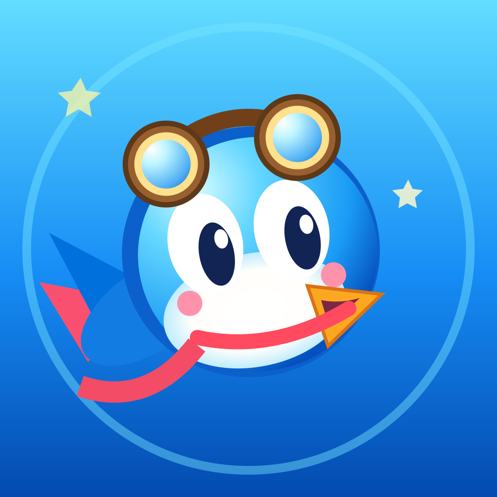

<h3>MALI LETOVI • VELIKE PRIČE</h3>

<strong>Poleti iznad oblaka. Otkrij čarobne svjetove. Neka svaki let bude nova avantura.</strong>

<a href="../../releases/latest"><strong>Preuzmi BOPAVI</strong></a> · <a href="#osam-svjetova-za-istraživanje">Pogledaj svjetove</a> · <a href="#upoznaj-svoje-letače">Upoznaj letače</a>

---

## Svaka avantura počinje jednim zamahom 🪽

Upoznaj **Bopija**, vedrog plavog pilota sa zlatnim naočalama, velikim srcem i krilima koja ga vode preko lebdećih otoka, začaranih dvoraca, kristalnog neba i slapova. U **BOPAVI-ju** jedan dodir znači novi zamah: zaobiđi prepreke, skupljaj kovanice i zvijezde te pronađi vlastiti ritam leta.

**Osam fantastičnih svjetova**, devet jedinstveno oslikanih letača i više od milijun proceduralnih izazova po svijetu donose avanturu koja se nastavlja. Nove dionice dolaze bez prekida trenutnog leta.

<strong>Android · iPhone · Igranje bez internetske prijave · Bez oglasa · Bez kupnje stvarnim novcem</strong>

## Pogledaj pravu igru

Ovo su **stvarne snimke pokrenute aplikacije** iz Android emulatora i iOS simulatora, a ne ilustracije iz konceptualnog dizajna. Galerija se ažurira sa svakim provjerenim GitHub izdanjem.

<table>
<tr>
<td align="center" width="25%"> <b>Početni zaslon</b></td>
<td align="center" width="25%"> <b>Odabir letača</b></td>
<td align="center" width="25%"> <b>Priprema za let</b></td>
<td align="center" width="25%"> <b>Let u tijeku</b></td>
<td align="center" width="25%"> <b>Rezultati</b></td>
</tr>
</table>
<table>
<tr>
<td align="center">
<em>Osam svjetova na Androidu</em>
</td>
<td align="center">
<em>Početni zaslon na iOS-u</em>
</td>
</tr>
</table>

## Osam svjetova za istraživanje

| Svijet | Avantura |
|:--|:--|
| 🌿 **Zeleni otoci** | Zeleni lebdeći otoci, dvorci i slapovi |
| 💎 **Kristalno nebo** | Svjetlucavi kristali i visoke nebeske građevine |
| 🌋 **Lava vrhovi** | Vulkanski krajolici, vatra i užarene prepreke |
| 🌙 **Noćni dvorci** | Mjesečina, tamni tornjevi i tajanstvene sjene |
| 🐚 **Biserno more** | Tirkizne dubine, koralji i biserni svijet |
| 🏛️ **Nebeske kule** | Drevni tornjevi, visoki otoci i portali |
| 🍄 **Čarobna šuma** | Začarana stabla, gljive i vilinska svjetla |
| 🪐 **Zvjezdani bezdani** | Kozmičke stijene, zvijezde i nebeske tajne |

Otključavaj levele redom, osvajaj zvjezdice, vraćaj se po bolji rezultat i nastavi letjeti kroz nove proceduralne dionice. Svaki svijet čuva tvoj napredak.

## Upoznaj svoje letače

Bopi je tek početak! Pronađi pilota koji odgovara tvojoj avanturi. Svih devet letača ima svoj ilustrirani izgled, a nova otključavanja koriste isključivo kovanice osvojene u igri.

<table>
<tr>
<td align="center"> <b>Portantin</b></td>
<td align="center"> <b>Noa</b></td>
<td align="center"> <b>Any</b></td>
</tr>
</table>

**Bopi · Sunny · Berry · Luna · Mint · Shadow · Portantin · Noa · Any**

Izaberi lika, pogledaj njegov status i potvrdi svoj odabir. Otključani letači ostaju tvoji, a napredak se ne gubi pri ažuriranju.

## Tvoj let, tvoja pravila

**Svaki prolaz te vodi bliže cilju.** Zlatna kruna svijetli na svakoj kovanici, a posljednji prolaz dionice obilježen je plavim čarobnim portalom.  Tijekom leta prati plavu traku od krune do ciljne zastavice, skupljaj zlatne kovanice i zvjezdice te čuvaj štit i magnet za trenutke kada ti najviše trebaju. Sve što vidiš na ekranu odražava tvoju stvarnu avanturu — od napretka do nagrada.

- **Dodirni za let:** svaki dodir pokreće novi zamah krilima.
- **Skupljaj nagrade:** kovanice, zvijezde i korisne dodatke.
- **Otkrij svoj ritam:** biraj između lakše, normalne i zahtjevnije težine.
- **Odmori kada poželiš:** nastavi, ponovi let ili se vrati u izbornik.
- **Istražuj dalje:** između uzastopnih proceduralnih levela let se nastavlja bez novog početka.
- **Čuvaj svoju avanturu:** najbolji rezultati, otključani likovi i napredak spremaju se lokalno.

## Tvoj letački dnevnik

**Svaki let ostavlja trag.** U vlastitom profilu vidiš odabranog pilota, osvojene rezultate, prikupljene kovanice, dovršene levele i pobjede. Četiri sjajne značke prate tvoje stvarne uspjehe, a tri najbolja svijeta vode te ravno do sljedećih izazova.

Odaberi drugog letača, promijeni svoje ime ili istraži kolekciju — sve je povezano s tvojim napretkom spremljenim na uređaju. **Nema obavezne registracije, izmišljenih nagrada ni računa u oblaku.**

## Otkrij što te čeka

<table>
<tr>
<td align="center"> <b>Profil</b> Vlastiti napredak</td>
<td align="center"> <b>Zadaci</b> Novi ciljevi</td>
<td align="center"> <b>Kolekcija</b> Tvoji letači</td>
<td align="center"> <b>Trgovina</b> Virtualne kovanice</td>
</tr>
</table>

## Preuzmi i poleti

BOPAVI je dostupan kao testno izdanje za Android i iOS. U [najnovijem izdanju](../../releases/latest) nalaze se Android APK i AAB te paketi za iOS simulator i uređaj. **APK je razvojni paket, a AAB i iOS device paket nisu potpisani za distribuciju kroz trgovine.** Za objavu u Google Playu i App Storeu potrebni su odgovarajući izdavački potpisi.

Tvoj napredak sprema se na uređaj. BOPAVI ne traži korisnički račun, nema oglase i ne nudi kupnju stvarnim novcem.

---

<strong>MALI LETOVI • VELIKE PRIČE</strong>

<em>BOPAVI je svijet koji se otkriva jednim zamahom.</em>

<strong>© Brendigo</strong>

