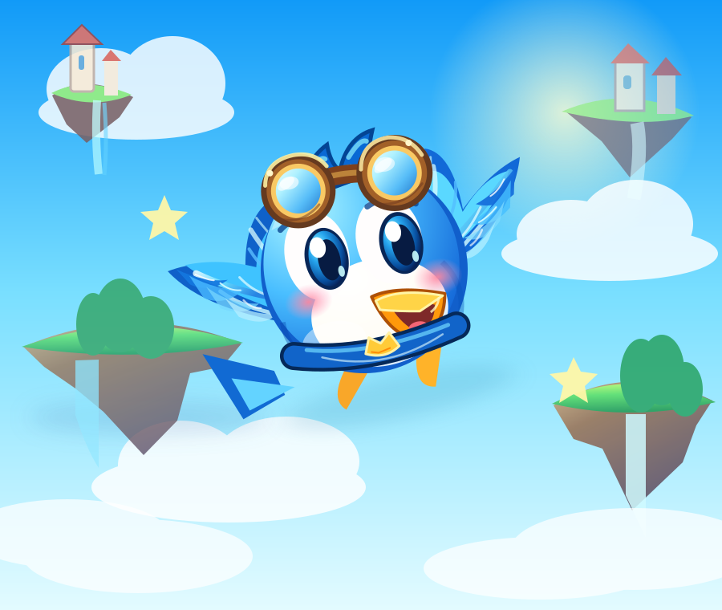

### MALI LETOVI • VELIKE PRIČE

**Jedan Bopi. Jedan dodir. Beskrajni let.**

[**Preuzmi BOPAVI**](https://github.com/bren-wp/BOPAVI/releases/latest)

**Android i iOS · Igra bez interneta · Bez oglasa · Bez registracije**

---

## Jednostavna premium igra

BOPAVI je lagana, offline arkadna igra u kojoj vodiš Bopija kroz šarene nebeske prepreke. **Dodirni zaslon za zamah krila, leti što dulje i pokušaj nadmašiti vlastiti rekord.**

Cijelo korisničko iskustvo sada ima samo tri koraka:

1. **IGRAJ** — jedan veliki gumb na početnom ekranu odmah otvara let.
2. **LET** — tapkaj za letenje, izbjegavaj prepreke i skupljaj bodove prolaskom.
3. **REZULTAT** — nakon sudara vidiš stvarni rezultat, ostvarene bodove i osobni rekord, uz **PONOVO** i **POČETNA**.

U letu postoji samo jednostavna pauza s **NASTAVI**, **PONOVO** i **IZLAZ**.

Više nema korisničkog odabira svjetova i levela, zasebne trgovine, profila, postavki, kartica postignuća ili zasebnih rekorda. Interni prethodno spremljeni podaci ostaju netaknuti kako starijim instalacijama ne bismo izbrisali napredak.

## Stvarne snimke aplikacije

<table>
<tr>
<td align="center"> <b>Početna</b></td>
<td align="center"> <b>Početak leta</b></td>
<td align="center"> <b>Let</b></td>
<td align="center"> <b>Rezultat</b></td>
</tr>
</table>

Snimke nastaju iz stvarnog Android emulatora u CI-ju; nisu marketinški mockupovi. Izdanje se objavljuje samo nakon prolaska testova.

## Privatnost i tehnička osnova

- Android: Kotlin, nativni UI i 2D gameplay
- iOS: Swift, UIKit i nativni 2D gameplay
- Offline-first: bez računa, oglasa ili praćenja korisnika
- Lokalno spremljen osobni rekord i postojeći podaci kompatibilni sa starijim izdanjima
- Zasebni izvorni testovi simulacije, sudara, migracija i pokretanja aplikacije

**Napomena o grafici:** 3D fantasy reference određuju željeni vizualni standard. Trenutni grafički resursi ne smiju se opisivati kao 100% 1:1 dok se usporedba stvarnih snimaka uređaja s izvornim referencama ne dovrši.

## Preuzimanje i razvoj

[Posljednje GitHub izdanje](https://github.com/bren-wp/BOPAVI/releases/latest) · [Automatizirani buildovi](https://github.com/bren-wp/BOPAVI/actions) · [Izvorni kod](https://github.com/bren-wp/BOPAVI)

© Brendigo
