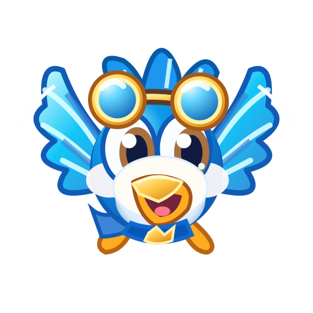
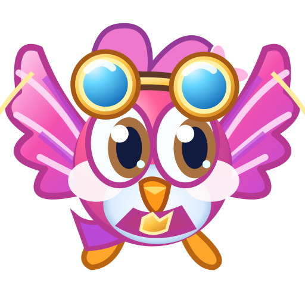
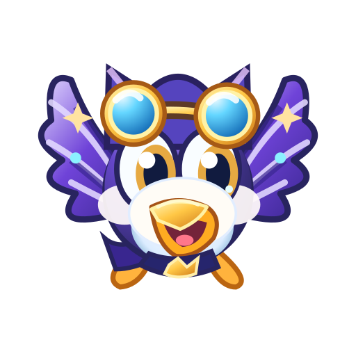

<h3>MALI LETOVI • VELIKE PRIČE</h3>

<strong>Soar above the clouds. Explore enchanted worlds. Make every flight an adventure.</strong>

<a href="../../releases/latest"><strong>Download BOPAVI</strong></a> · <a href="#eight-worlds-to-explore">Explore the worlds</a> · <a href="#meet-the-pilots">Meet the pilots</a>

---

## Every adventure begins with a wingbeat 🪽

Meet **Bopi**, a cheerful blue pilot with golden goggles, a brave heart, and wings that carry him across floating islands, enchanted castles, crystal skies, and waterfalls. All **eight BOPAVI worlds use the same tap-to-flap controls: one tap means one wingbeat**. Avoid obstacles, collect coins and stars, and find your own rhythm.

**Eight fantasy worlds**, nine individually illustrated pilots, and over one million procedural challenges per world make for an adventure that keeps going. New stages appear without interrupting your flight.

<strong>Android · iPhone · No online account · No ads · No real-money purchases</strong>

## See the actual game

These are **real screenshots of the running Android and iOS applications**, not concept mockups. The gallery updates with verified GitHub releases. Actual visuals have not yet been verified as a 1:1 match to the reference illustrations.

<table>
<tr>
<td align="center" width="25%"> <b>Home screen</b></td>
<td align="center" width="25%"> <b>Pilot selection</b></td>
<td align="center" width="25%"> <b>Flight preview (Priprema za let)</b></td>
<td align="center" width="25%"> <b>Active flight</b></td>
<td align="center" width="25%"> <b>Results</b></td>
</tr>
</table>
<table>
<tr>
<td align="center">
<em>Eight Android worlds</em>
</td>
<td align="center">
<em>iOS home screen</em>
</td>
<td align="center">
<em>Your flight journal</em>
</td>
<td align="center">
<em>Customize your flight</em>
</td>
</tr>
</table>

## Eight worlds to explore

| World | Adventure |
|:--|:--|
| 🌿 **Zeleni otoci** | Verdant floating islands, castles, and waterfalls |
| 💎 **Kristalno nebo** | Shimmering crystals and towering sky architecture |
| 🌋 **Lava vrhovi** | Volcanoes, fire, and glowing hazards |
| 🌙 **Noćni dvorci** | Moonlight, dark towers, and mysterious shadows |
| 🐚 **Biserno more** | Turquoise depths, coral, and a pearlescent realm |
| 🏛️ **Nebeske kule** | Ancient towers, high islands, and portals |
| 🍄 **Čarobna šuma** | Enchanted trees, mushrooms, and fairy lights |
| 🪐 **Zvjezdani bezdani** | Cosmic rocks, stars, and astral mysteries |

Unlock levels in order, collect stars, chase personal bests, and continue into fresh procedural stages. Progress is tracked independently for each world.

## Meet the pilots

Bopi is only the beginning. Choose the pilot who fits your adventure. Each of the nine pilots has a distinct illustrated identity; additional pilots are unlocked using coins earned in the game, never real money.

<table>
<tr>
<td align="center"> <b>Vihor</b></td>
<td align="center"> <b>Iskra</b></td>
<td align="center"> <b>Orion</b></td>
</tr>
</table>

**Bopi · Sunny · Berry · Luna · Mint · Shadow · Vihor · Iskra · Orion**

Pick a character, check their availability, and confirm your choice. Your unlocked pilots and existing progress are retained across upgrades.

## Your flight, your rules

**Every gate takes you closer to the finish.** Crown-shaped gold coins and a blue magic portal mark the course. Watch the progress gauge, collect stars and coins, and save shields and magnets for the moments you need them. On-screen progress and rewards come from actual gameplay state, not mock data.

- **Control your flight:** one touch equals one wingbeat in all eight worlds; gravity naturally carries the pilot downward.
- **Collect rewards:** coins, stars, and useful power-ups.
- **Set the pace:** choose easy, normal, or hard difficulty.
- **Pause anytime:** resume, retry, or return to the menu.
- **Fly further:** continuous procedural levels transition without starting a new run.
- **Set personal records:** your ten best recorded flights form your private leaderboard.

## Your flight journal

**Every flight counts.** Your profile shows the selected pilot, earned scores, coins, completed levels, and victories. Achievement badges explain their requirements, while your most-played worlds guide you toward new challenges. Star progress reflects real earned results, not fabricated experience points.

Change pilots, update your nickname, or explore your collection. **Moji rekordi** (My Records) displays only your own scores; changing a nickname never deletes past flights. There is no public leaderboard or mandatory registration.

## Discover more

<table>
<tr>
<td align="center"> <b>Profile</b> Your progress</td>
<td align="center"> <b>Tasks</b> New goals</td>
<td align="center"> <b>Collection</b> Your pilots</td>
<td align="center"> <b>Shop</b> Virtual coins</td>
</tr>
</table>

## Download and play

The [latest verified release](../../releases/latest) includes an Android APK and AAB plus iOS simulator and device build archives. **The AAB and iOS device archive are not distribution-signed**; store submission requires publisher signing. The APK is provided for direct installation and testing.

BOPAVI has no online leaderboard, user accounts, advertisements, or real-money purchases. Progress can be exported or imported on demand; it remains stored locally.

---

<strong>MALI LETOVI • VELIKE PRIČE</strong>

<em>Discover a new world with every wingbeat.</em>

<strong>© Brendigo</strong>

