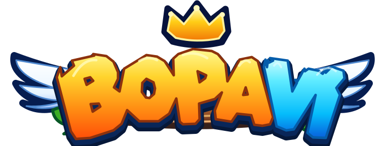
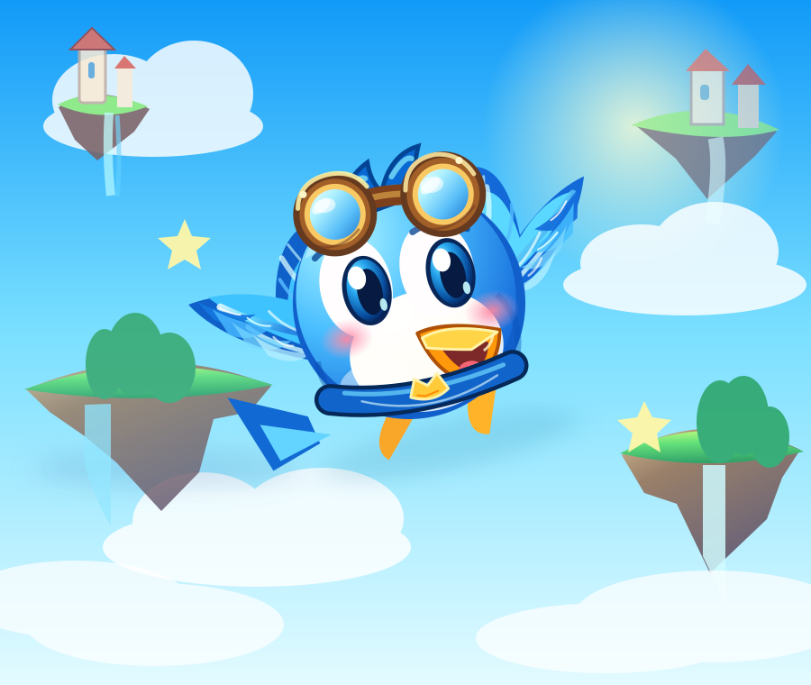

### MALI LETOVI. VELIKE PRIČE.

**Raširi krila. Uhvati ritam. Poleti u čarobnu avanturu.**

**[PREUZMI BOPAVI ZA ANDROID](https://github.com/bren-wp/BOPAVI/releases/latest)**

*Besplatna igra. Bez oglasa. Bez praćenja. Bez registracije.*

---

## Mala krila, velika avantura

Iznad oblaka čeka te svijet nebeskih otoka, slapova i neočekivanih prepreka. Upoznaj Bopija i njegove prijatelje te otkrij koliko daleko možeš poletjeti. Svaki dodir pokreće novi zamah krila, a svaki pokušaj novu priliku za osobni rekord.

**Jednostavno za naučiti. Uzbudljivo za savladati.** Odaberi junaka, pritisni **IGRAJ** i uhvati ritam leta.

## Zašto zaigrati?

- 🪽 **Jedan dodir, potpuna kontrola.** Dodirni zaslon i upravljaj zamahom krila.
- ☁️ **Čarobni svijet iznad oblaka.** Leti između lebdećih otoka i živopisnih krajolika.
- 🍓 **Prikupi bobice.** Izvuci najbolje iz svakog leta.
- 🏆 **Sruši svoj rekord.** Prati svoje uspjehe i napredak na uređaju.
- 🎮 **Odaberi svojega junaka.** Bopi, Sova ili Lisac čekaju tvoj poziv.
- 💙 **Igraj bez ometanja.** Ne trebaju ti račun ni obvezna mrežna veza.

## Pogledaj sve zaslone igre

Ovdje su stvarne snimke Android aplikacije, zabilježene tijekom provjera na emulatoru. Nisu konceptni prikazi. Svaka se snimka može otvoriti u punoj rezoluciji kroz datoteke posljednjeg verificiranog GitHub izdanja.

<table>
<tr>
<td align="center"></td>
<td align="center"></td>
<td align="center"></td>
<td align="center"></td>
</tr>
<tr>
<td align="center"><strong>Čarobni početak</strong></td>
<td align="center"><strong>Početna avantura</strong></td>
<td align="center"><strong>Spreman za let</strong></td>
<td align="center"><strong>U letu</strong></td>
</tr>
<tr>
<td align="center"></td>
<td align="center"></td>
<td align="center"></td>
<td align="center"></td>
</tr>
<tr>
<td align="center"><strong>Pauza</strong></td>
<td align="center"><strong>Rezultati</strong></td>
<td align="center"><strong>Odabir junaka</strong></td>
<td align="center"><strong>Nadogradnje</strong></td>
</tr>
<tr>
<td align="center"></td>
<td align="center"></td>
<td align="center"></td>
<td align="center"></td>
</tr>
<tr>
<td align="center"><strong>Detaljne postavke</strong></td>
<td align="center"><strong>Postignuća</strong></td>
<td align="center"><strong>Poredak</strong></td>
<td align="center"><strong>Karta razina</strong></td>
</tr>
<tr>
<td align="center"></td>
<td align="center"></td>
<td align="center"></td>
<td align="center"></td>
</tr>
<tr>
<td align="center"><strong>Opcije igre</strong></td>
<td align="center"><strong>Rekordi</strong></td>
<td align="center"><strong>Privatnost</strong></td>
<td align="center"><strong>Uvjeti korištenja</strong></td>
</tr>
</table>

## Kako igrati?

**1.** Odaberi Bopija, Sovu ili Lisca pa pritisni **IGRAJ**.

**2.** Dodiruj zaslon kako bi junak zamahivao krilima.

**3.** Izbjegavaj prepreke, skupljaj bobice i pokušaj odletjeti što dalje.

**4.** Pauziraj kada poželiš, pogledaj rezultat i nastavi prema novom rekordu.

Postavke zvuka i težine prilagodi svojem stilu igranja.

## Privatnost je dio avanture

**Bez oglasa. Bez praćenja. Bez registracije.** Rezultati se pohranjuju lokalno i osnovno igranje ne zahtijeva internet.

[Politika privatnosti](docs/play/PRIVACY_POLICY.md) · [Uvjeti korištenja](docs/play/TERMS_OF_USE.md)

## Preuzimanje

**[Najnovije Android izdanje — APK i dodatne datoteke](https://github.com/bren-wp/BOPAVI/releases/latest)**

Debug APK namijenjen je testiranju. Nepotpisani release APK/AAB zahtijevaju odgovarajući privatni ključ za proizvodnu objavu i kompatibilne nadogradnje.

---

**BOPAVI — Mali letovi. Velike priče.**

Stvorio **[Brendigo](https://brendigo.com)** · © 2026 Brendigo

